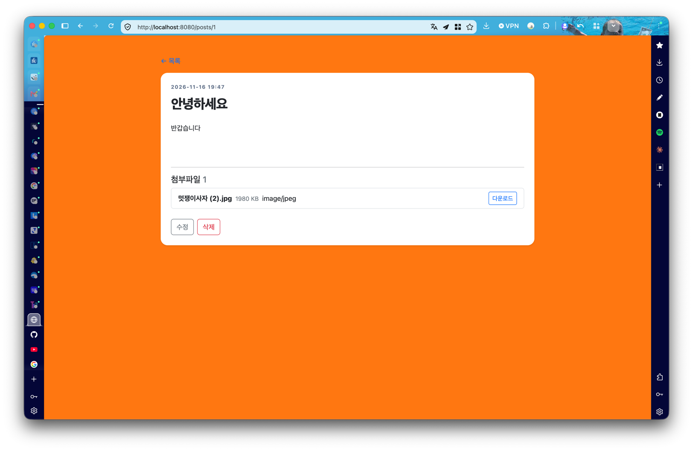
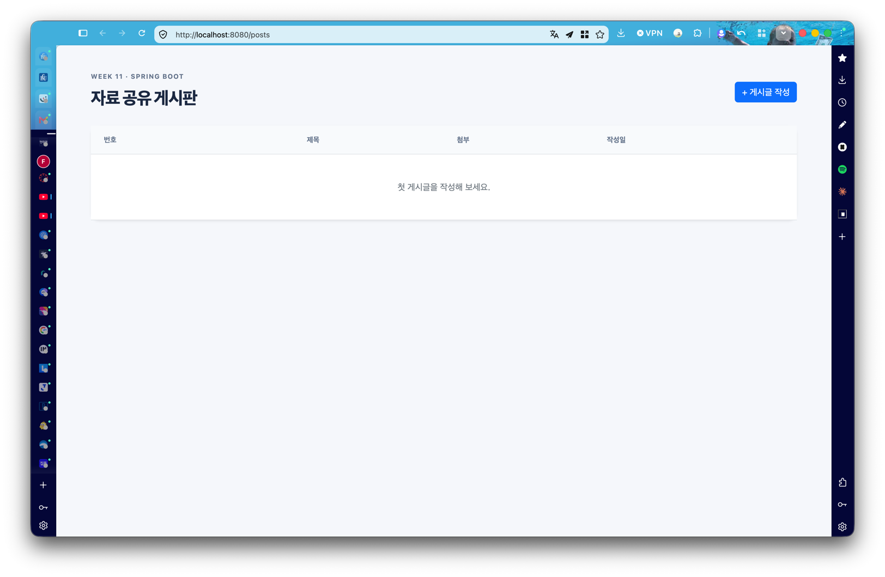
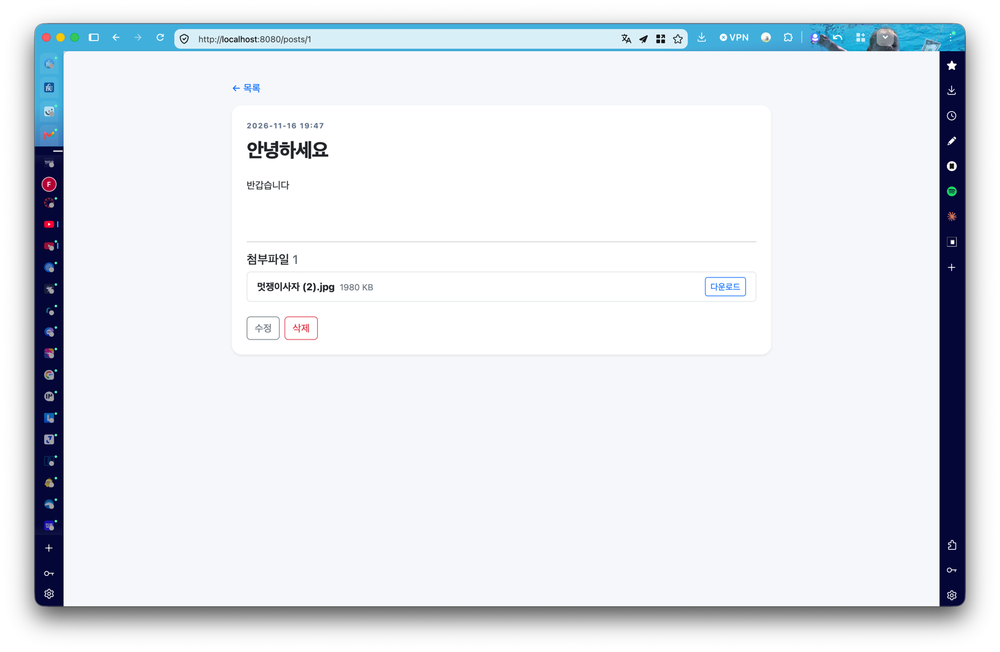
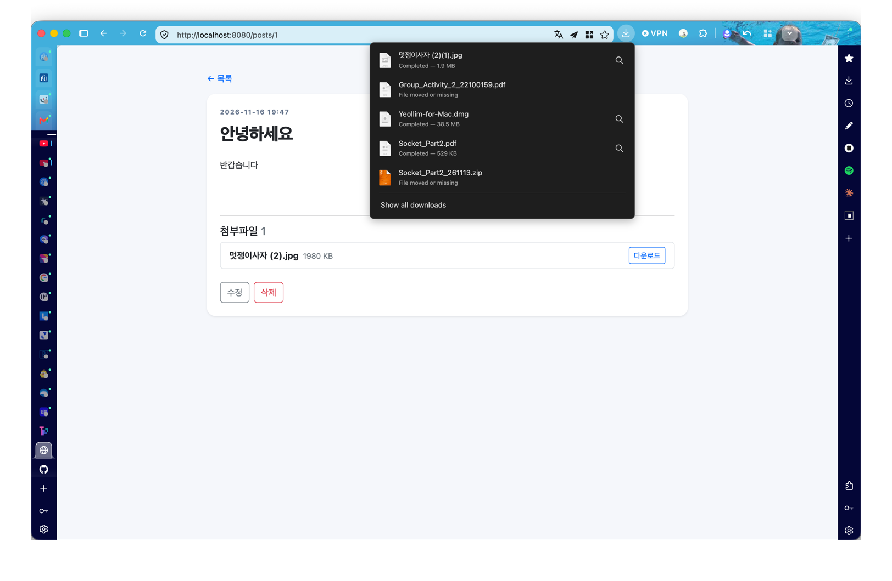
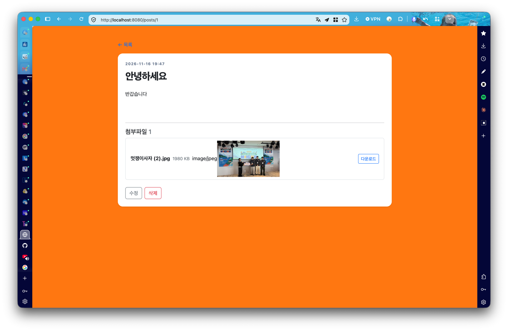

# 11주차 파일 첨부 게시판

Render URL:

## Project Information

Spring Boot로 만든 게시판이다. 게시글 CRUD와 파일 업로드·다운로드 코드를 분석하고, 화면을 수정하고 이미지 미리보기를 추가했다.

- GitHub Classroom: https://github.com/2026-2-WebService/assign11-c01-22100159
- 사용 기술: Java 17, Spring Boot 3.5.7, Thymeleaf, JPA, MariaDB

## Installation

JDK 17과 MariaDB를 준비하고 DB를 생성한다.

```sql
CREATE DATABASE web11 CHARACTER SET utf8mb4;
```

실행 환경에 다음 값을 설정한다.

- `DB_URL`: DB 주소. 예: `jdbc:mariadb://localhost:3306/web11`
- `DB_USERNAME`: DB 계정
- `DB_PASSWORD`: DB 비밀번호
- `UPLOAD_DIR`: 파일 저장 폴더. 기본값 `uploads`
- `PORT`: 서버 포트. 기본값 `8080`

IntelliJ의 실행 설정에 환경변수를 넣고 `AttachmentBoardApplication`을 실행한다. 터미널에서는 환경변수를 따로 설정한 뒤 아래 명령어를 실행한다.

```bash
./gradlew bootRun
```

접속 주소는 http://localhost:8080/posts 이다. 실제 파일은 `uploads/`에 저장하고, 파일 정보는 MariaDB의 `attachments` 테이블에 저장한다. 실제 업로드 파일과 DB 비밀번호는 Git에 올리지 않는다.

Gradle Wrapper는 8.14.3을 사용한다. 실행 파일은 아래 명령어로 빌드한다.

```bash
./gradlew clean bootJar
```

## Source Code Exploration

아래 Java 파일 경로는 `src/main/java/edu/handong/web11/` 기준이다.

### 1. Controller, Service, Repository의 역할

Controller는 사용자의 요청을 처리하고, Service는 비즈니스 로직을 담당하며, Repository는 DB 접근을 담당한다. 목록 조회는 `PostController.list()` → `PostService.all()` → `PostRepository.findAll(Sort)` 순서로 진행된다.

관련 파일: `controller/PostController.java`, `service/PostService.java`, `repository/PostRepository.java`

### 2. 폼 입력값과 첨부파일 전달

폼은 POST 방식과 `multipart/form-data` 형식으로 데이터를 보낸다. `PostController.create()`는 `@ModelAttribute`로 제목과 내용을 `PostForm form`에 받고, `@RequestParam(name = "files")`로 첨부파일을 `List<MultipartFile> files`에 받는다.

관련 파일: `src/main/resources/templates/posts/form.html`, `controller/PostController.java`, `dto/PostForm.java`

### 3. Post와 Attachment의 관계

게시글 하나에 여러 첨부파일이 올라갈 수 있으므로 일대다 관계이다. `Post`의 `@OneToMany`는 첨부파일 목록을 연결하고, `Attachment`의 `@ManyToOne`은 각 첨부파일이 속한 게시글을 연결한다. `Post.addAttachment()`는 양쪽에 이 관계를 설정한다.

관련 파일: `domain/Post.java`, `domain/Attachment.java`

### 4. cascade와 orphanRemoval

`cascade = CascadeType.ALL`은 게시글의 저장·삭제 등의 작업을 첨부파일 엔티티에도 전파한다. `orphanRemoval = true`는 목록에서 제거되어 게시글과의 관계가 끊어진 첨부파일의 DB 레코드를 삭제한다. 실제 파일은 별도로 관리되므로, `PostService.delete()`에서 `FileStorageService.deleteIfExists()`를 호출해 지운다.

관련 파일: `domain/Post.java`, `service/PostService.java`, `service/FileStorageService.java`

### 5. MultipartFile과 파일 저장 과정

`MultipartFile`은 업로드된 첨부파일 하나를 다루는 인터페이스이다. `FileStorageService.store()`는 파일 이름·확장자·크기 등을 검사하고 UUID 파일명과 저장 경로를 만든다. 이후 `getInputStream()`으로 파일 내용을 읽고 `Files.copy()`로 저장한다. 반환된 첨부파일 정보는 `PostService.create()`에서 게시글과 함께 DB에 저장한다.

관련 파일: `service/FileStorageService.java`, `service/PostService.java`

### 6. UUID 파일명을 사용하는 이유

원본 이름으로 저장하면 같은 이름의 파일이 기존 파일을 덮어쓸 수 있다. UUID 이름은 이런 충돌 가능성을 줄인다. 원본 이름은 DB에 따로 보관해 다운로드할 때 사용한다.

관련 파일·메서드: `service/FileStorageService.java`의 `store()`, `controller/AttachmentController.java`의 `download()`

### 7. 다운로드 응답

`Resource`는 파일을 읽고 다루기 위한 것으로, `FileStorageService.load()`에서는 `PathResource`를 반환한다. `ResponseEntity`는 HTTP 상태 코드·헤더·본문을 담으며, `download()`에서는 본문에 파일 리소스를 넣는다. `Content-Disposition`의 `attachment`는 다운로드를 안내하고, `filename`은 저장할 파일명을 알려준다.

관련 파일·메서드: `service/FileStorageService.java`의 `load()`, `controller/AttachmentController.java`의 `download()`

### 8. normalize()와 startsWith()

`normalize()`는 경로의 `.`과 `..`를 정리하고, `startsWith(uploadDir)`는 그 경로가 업로드 폴더 안인지 확인한다. 지정한 폴더 밖에 파일이 저장되는 것을 막기 위한 검사이다.

관련 파일·메서드: `service/FileStorageService.java`의 `store()`

### 코드 주석

- `PostController.create()`: 입력값 검증, 파일 전달, 저장 후 화면 이동
- `FileStorageService.store()`: 파일 검증, UUID 이름과 경로 생성, 파일 저장과 실패 처리
- `AttachmentController.download()`: 파일 조회, 다운로드 헤더와 응답 구성

## Customizing

### Text

`src/main/resources/templates/posts/list.html`에서 탭 제목과 게시판 제목을 “자료 공유 게시판”에서 “업로드를 해볼까요~~~?”로 바꿨다.

### Style

`src/main/resources/static/css/app.css`에서 배경색을 `#f5f7fb`에서 주황색 `#FF7710`으로 바꿨다.

### UI/Data

`src/main/resources/templates/posts/detail.html`에서 파일명과 크기 옆에 MIME 타입도 표시하도록 바꿨다. `file.contentType`을 사용했고 `ms-2`로 간격을 줬다.

변경 전은 아래 초기 화면과 업로드 캡처에서 볼 수 있다.



## New Feature

`AttachmentController.view()`에 `/attachments/{id}/view` 경로를 추가했다. JPG·JPEG, PNG, GIF의 MIME 타입만 허용하고, `inline`과 파일의 Content-Type을 지정해 이미지를 반환한다.

`src/main/resources/templates/posts/detail.html`에서는 `th:if`로 이미지인지 검사한 뒤 ``로 표시한다. 이미지가 아닌 파일은 기존 다운로드 버튼을 사용한다. `AttachmentController.view()`는 없는 첨부파일 ID를 404로 처리하고, `FileStorageService.load()`는 디스크에 파일이 없으면 404로 처리한다. 미리보기를 지원하지 않는 타입은 415로 처리한다.

## Testing & Deployment

로컬에서 확인한 내용이다.

- `./gradlew clean bootJar` 빌드 성공
- DB 연결과 게시글 작성·조회·수정·삭제
- JPG 업로드와 다운로드 완료
- `uploads`의 UUID 파일명과 DB의 원본 이름·저장 이름·게시글 ID
- 상세 화면의 이미지 미리보기와 저장 파일·응답 내용 일치
- 이미지가 아닌 파일의 다운로드·열기, 수정 후 첨부파일 유지
- 없는 첨부파일 ID 요청의 404 응답

### 초기 화면



### 업로드



### 다운로드



### 이미지 미리보기



### 배포

Classroom 저장소의 `main` 브랜치에 소스와 캡처를 Push했다. `Dockerfile`은 Java 17 환경에서 JAR를 빌드하고 실행한다. Render에도 `DB_URL`, `DB_USERNAME`, `DB_PASSWORD`를 환경변수로 설정한다.

Render 재배포 결과와 배포 환경의 기능 동작은 아직 확인하지 못했다.

## Weekly Review

### 새롭게 배운 내용

1. Controller, Service, Repository가 각각 요청 처리, 비즈니스 로직, DB 접근을 맡는다.
2. DB의 첨부파일 레코드를 삭제해도 실제 파일은 별도로 삭제해야 한다.
3. UUID로 저장 이름을 만들고 원본 이름은 따로 보관할 수 있다.

### 어려웠던 점과 해결 방법

`MultipartFile`에 제목과 내용도 포함되는 줄 알았는데, 코드를 보면서 파일만 받는다는 것을 알았다. DB 레코드 삭제와 실제 파일 삭제도 같은 작업인 줄 알았지만, 삭제 메서드를 따라가며 구분했다. Render 빌드에서는 Java 18을 요구하는 코드와 Java 17 Docker 환경이 맞지 않는 오류가 있었다. Java 17로 맞춘 코드를 제출 저장소에 반영하고 로컬 빌드를 확인했다.

### AI 활용 내용 및 느낀 점

AI의 질문과 힌트를 보며 코드를 읽고 직접 답했다. 주석과 미리보기 코드를 설명받고 직접 적용했다. 환경 설정, 오류 해결, 테스트와 Git 병합에도 도움을 받았고, 내가 답한 내용을 README로 정리하도록 요청했다.

직접 코드를 따라가니 파일 저장과 DB 저장이 다른 작업이라는 점이 이해됐다.
